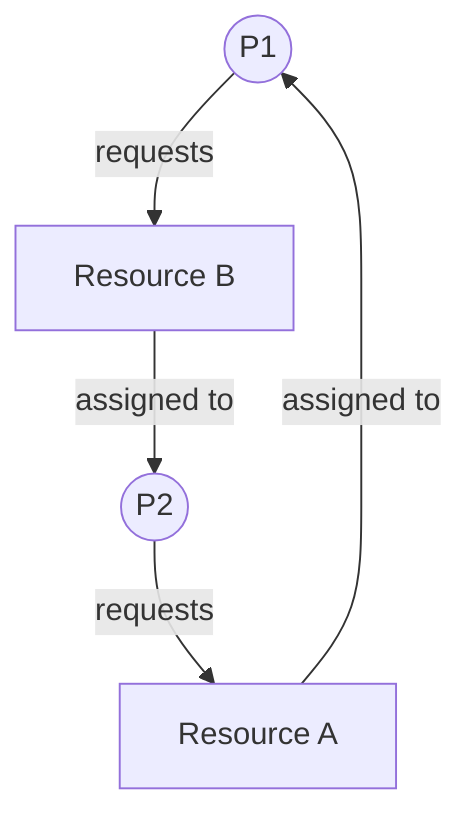
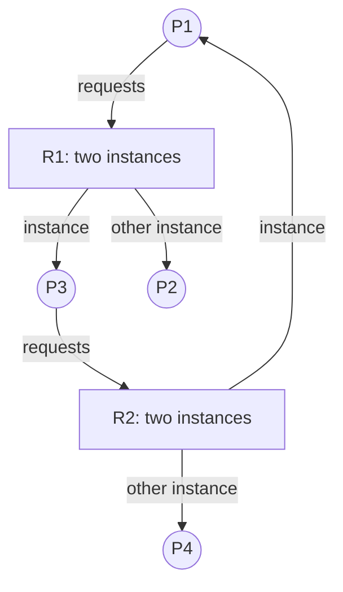

## Resources and cycles

A process requests, uses and releases resources. Deadlock requires <mark>mutual exclusion, hold and wait, no preemption, and circular wait</mark>. In a resource-allocation graph, <mark>process → resource is a request</mark>, and resource instance → process is an assignment. A cycle implies deadlock for single-instance resource types; with multiple instances a cycle alone is insufficient.

## Prevention and avoidance

Prevention breaks a necessary condition: total resource ordering breaks circular wait, including for dining philosophers; all-at-once acquisition breaks hold and wait. Avoidance checks proposed grants against future claims. Banker’s algorithm uses <mark>Need = Max − Allocation</mark> and starts Work = Available; when Need ≤ Work, simulate that process finishing and add its Allocation to Work. A state is safe if all processes can finish in some order. <mark>Unsafe does not mean already deadlocked</mark>. Single-instance avoidance can use claim edges.

## Detection and recovery

A single-instance wait-for graph connects a waiting process to the holder, with a cycle indicating deadlock. Multi-instance detection uses current requests and allocations rather than declared maximum future demand. Recovery can terminate processes or preempt resources and roll back when possible; victim selection must consider cost and starvation.

## Work the lecture’s Banker’s algorithm example

There are ten instances of one resource type. Two are available initially.

| Process | Allocated | Maximum | Remaining need |
| --- | ---: | ---: | ---: |
| P1 | 1 | 6 | 5 |
| P2 | 1 | 5 | 4 |
| P3 | 2 | 4 | 2 |
| P4 | 4 | 7 | 3 |

- **P4 requests 1:** pretend to grant it. Work is now 1 and P4 still needs 2. No process can finish, so roll back the unsafe grant. Unsafe does not mean currently deadlocked.
- **P3 requests 1:** Work is now 1, P3 needs 1 and holds 3. `P3 → P2 → P1 → P4` works: available grows `1 → 4 → 5 → 6 → 10`. Add back **Allocation**, not Max or Need.
- For any request, first check it against remaining need and availability. With multiple resource types, check each component separately. Then simulate the grant and run the safety check before committing.

Assignments come from instance dots, requests point to the resource box. With multiple instances, another process outside the cycle might finish and release the needed instance. Avoidance for single-instance resources uses dashed claim edges; simulate changing a request to an assignment and reject a resulting cycle. Detection uses outstanding requests, not possible future claims. With multiple instances, mark zero-allocation processes finished, repeatedly simulate finishing holders whose current requests fit Work, and identify any remaining holders as deadlocked.

### Track Work after the tentative P3 grant

| Choose next | Work before | Need | Allocation returned | Work after |
| --- | ---: | ---: | ---: | ---: |
| P3 | 1 | 1 | 3 | 4 |
| P2 | 4 | 4 | 1 | 5 |
| P1 | 5 | 5 | 1 | 6 |
| P4 | 6 | 3 | 4 | 10 |

Read each row as a test: **is Need ≤ Work?** If yes, simulate completion and add back Allocation. For the P4 grant, no first row is possible: Work is 1 and every Need is at least 2.

### Dining philosophers and recovery

Philosopher `p` needs forks `p` and `(p+1) mod 5`. All five can take their first fork and wait forever. Let philosopher 4 take fork 0 first so everybody acquires in increasing order. This breaks circular wait, not necessarily starvation. Requesting all resources together breaks hold-and-wait but lowers utilization. Releasing already-held resources on a failed try-acquire breaks no-preemption but may cause livelock. Share resources when their semantics allow it. For recovery, consider terminating all victims or one at a time, or preempting with rollback. Choose victims based on priority, lost work, holdings and remaining needs; avoid always picking the same process.

## Exam focus: when a cycle is not a deadlock

A cycle implies deadlock with <mark>one instance per resource type</mark>. With multiple instances, <mark>check who can finish and release a resource</mark>.

PDF page 11 shows this counterexample. The extra assignments go to **P2 and P4**, neither of which has an outstanding request. If P2 finishes, its R1 instance lets P1 advance and release R2 for P3. Alternatively, P4 can release R2 first. The cycle alone is not sufficient.

Page 33 quotes **O(n²)** for its wait-for graph example (a matrix representation), and **O(mn²)** for repeated multi-instance detection scans, with n processes and m resource types. A wait-for graph stored as adjacency lists can instead be searched in O(vertices + edges). Detection asks whether outstanding requests can finish; avoidance asks whether maximum future needs can finish.
