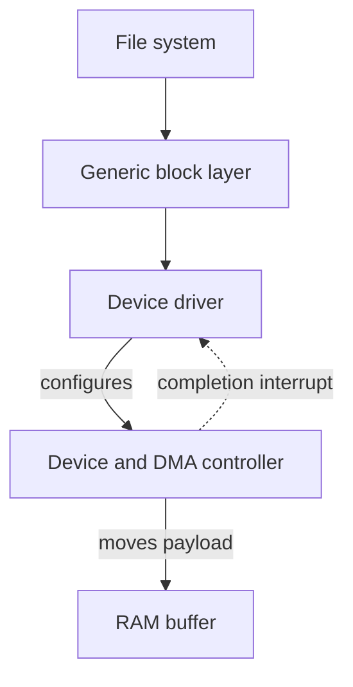
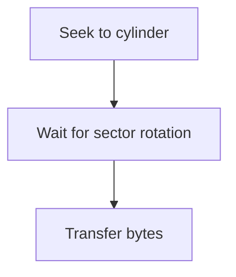
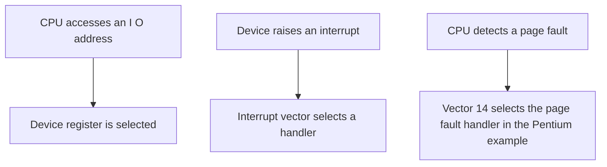

## Device interfaces

A device connects through ports and buses; bus hierarchy balances speed and cost. A controller exposes status, command and data registers. <mark>Port-mapped I/O</mark> uses special instructions; <mark>memory-mapped I/O</mark> uses addresses mapped to device registers, not normal RAM. A typical protocol checks readiness, transfers data and issues a command.

## Polling, interrupts and DMA

Polling checks for completion repeatedly; <mark>interrupts let other work run</mark> but have handling overhead. The interrupt controller routes events, and the vector selects the handler. A paging I/O completion can unblock a process. DMA lets the controller <mark>transfer data between the device and RAM</mark> after CPU setup. Drivers translate general kernel requests into device-specific operations; the file-system stack layers abstractions over the driver.

## Disks and scheduling

Platters have tracks and sectors; tracks at the same radius form a cylinder. Access includes seek, rotational latency and transfer. FCFS preserves arrival order; SSTF chooses nearest pending request and can starve distant ones. SCAN sweeps in both directions; C-SCAN services in one direction and returns to the start. Formatting, logical blocks, boot blocks and bad-block handling prepare media for use.

## Follow a device request

High-speed devices attach nearer the CPU and memory; downstream buses accommodate slower peripherals. PCI and legacy AGP are expansion interconnects, ATA/SATA attach storage, and USB and legacy ISA serve peripheral devices. A controller can contain local memory and a microcontroller. Status reports busy/completion/error; command initiates work; data registers carry payload in programmed I/O. A typical protocol waits for idle, transfers data as appropriate, issues a command and waits for completion.

| Method | CPU while device works | Payload moved by |
| --- | --- | --- |
| Polling with programmed I/O | Rechecks status | CPU |
| Interrupt-driven programmed I/O | Runs other work before completion ISR | CPU |
| DMA with completion interrupt | Sets addresses and length, then runs other work | DMA hardware |

The interrupt vector table maps events to handlers; priority allows higher-priority interrupts to preempt lower ones, and maskable interrupts can be disabled. Pentium vector 14 is the synchronous page-fault exception: requester faults → waits while disk loads the page → device completion interrupt → OS makes requester runnable. Polling may be cheaper for very short operations; too many interrupts can cause livelock. Devices differ by stream/block transfer, sequential/random access, blocking behavior, sharing, speed and I/O direction.

## Calculate disk movement

Access time = seek + rotational delay + transfer. At 7,200 RPM a revolution takes 8.33 ms, so average rotational delay is about 4.17 ms. Logical block addresses number sectors without requiring the caller to specify physical geometry. SPTF considers rotational delay as well as seek distance.

Lecture queue: `98, 183, 37, 122, 14, 124, 65, 67`; start at 53.

| Method | Path | Cylinders moved |
| --- | --- | ---: |
| FCFS | 53 → 98 → 183 → 37 → 122 → 14 → 124 → 65 → 67 | 640 |
| SSTF | 53 → 65 → 67 → 37 → 14 → 98 → 122 → 124 → 183 | 236 |
| Reverse at last request | 53 → 37 → 14 → 65 → 67 → 98 → 122 → 124 → 183 | 208 |
| Reverse at physical end 0 | 53 → 37 → 14 → 0 → 65 → 67 → 98 → 122 → 124 → 183 | 236 |

The lecture’s SCAN caption gives 208, but its drawing reverses at cylinder 0. See the worked discrepancy below. For an exam problem, record the <mark>starting direction and reversal convention</mark>. C-SCAN services one direction then wraps. Sum absolute differences between consecutive stops, including wrap travel if the question counts it.

Low-level formatting organizes sectors with control data and ECC. Partitioning subdivides storage; logical formatting builds the file system. Tiny bootstrap code loads fuller boot code that can interpret the layout. Bad sectors can be marked unusable or remapped to spares.

## Exam focus: check the reversal point on the actual graph

An <mark>interrupt notifies</mark> the CPU; <mark>DMA moves the payload</mark>. When calculating head travel, count the physical stops drawn in the trace.

### Follow the CPU while the device works

| Method | Start | While the device works | Completion |
| --- | --- | --- | --- |
| Polling + programmed I/O | CPU issues command | CPU repeatedly checks status | CPU moves payload through device registers as needed |
| Interrupt + programmed I/O | CPU issues command | Caller sleeps; another task can run | Interrupt notifies CPU; CPU still moves payload as needed |
| DMA + completion interrupt | Driver programs address and length | DMA moves payload; another task can run | Interrupt notifies CPU that the transfer finished |

These are the distinctions drawn on PDF pages 16 and 23. **Polling vs. interrupt** answers how you learn that the device is ready; **programmed I/O vs. DMA** answers who moves the bytes. Timing of individual transfers depends on the device protocol.

A memory-mapped register uses a CPU load/store but is routed to the device, not ordinary RAM. A port-mapped register uses a separate I/O address space and special instructions. The PC port and Pentium vector tables in the PDF illustrate two different namespaces, not interchangeable numbers.

For the same queue as the lecture, use cylinders 0–199, start at 53 moving downward, and count wrap travel. **C-SCAN** goes `53 → 37 → 14 → 0 → 199 → 183 → 124 → 122 → 98 → 67 → 65` (386 cylinders). **C-LOOK** skips physical ends: `53 → 37 → 14 → 183 → 124 → 122 → 98 → 67 → 65` (326 cylinders). Neither serves requests while wrapping. Page 38 is internally inconsistent: its graph visibly reaches **0**, but its caption says **208**. The drawn path totals **236**; **208** is the total if the head reverses at 14. On a test, show the path and sum, not only the final number.
