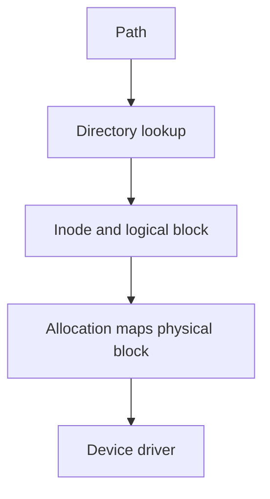
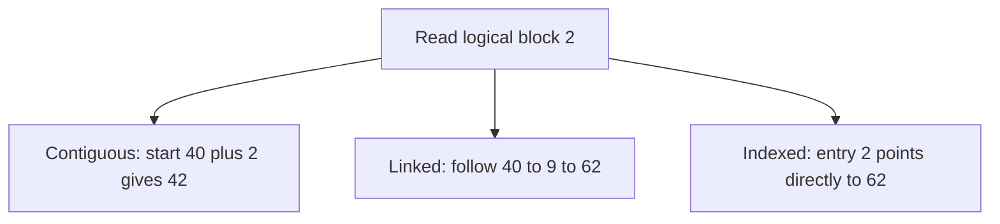
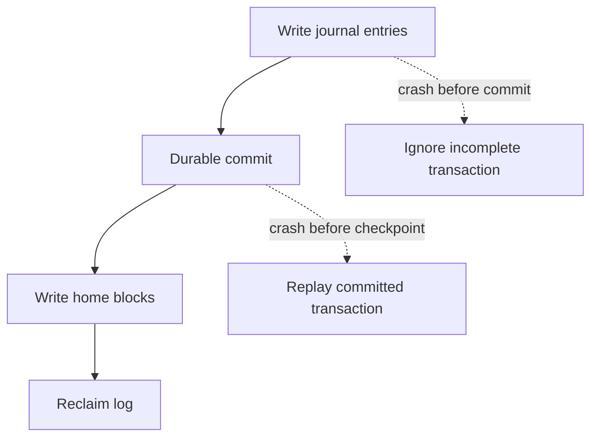
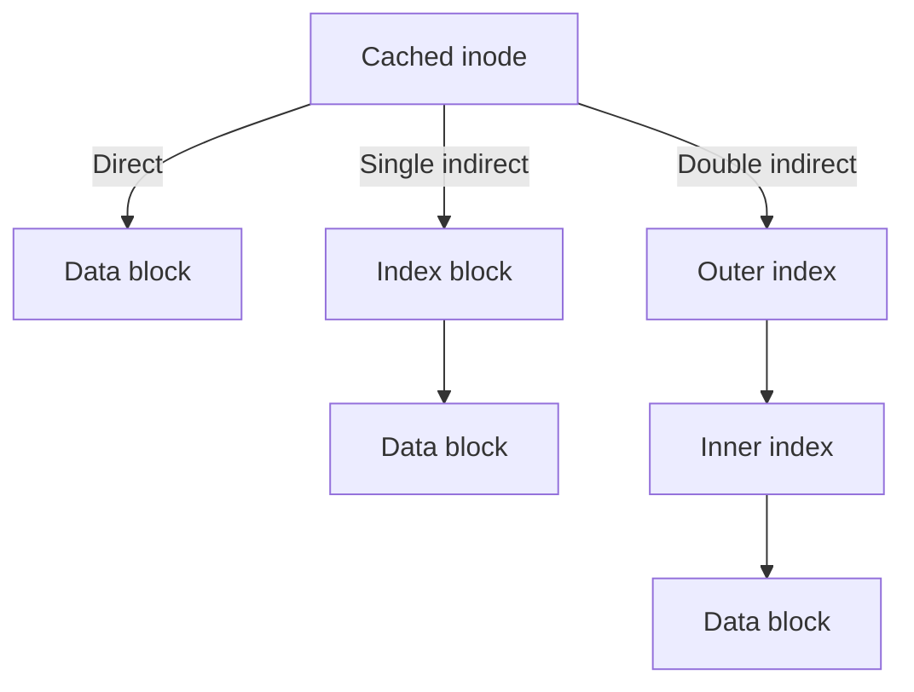

## Files and directories

A file is a named abstraction with content and metadata; its layout can be a byte sequence, records or an executable format. File operations include create, open, read, write, reposition, close and delete. <mark>A directory maps names</mark> to files or other directories. Flat, two-level and tree structures offer different naming and grouping tradeoffs; relative paths start from the working directory.

## Mounting and allocation

Partitions divide a disk; mounting makes another filesystem accessible at a path. <mark>Contiguous allocation</mark> maps offset to start+offset, but growth and fragmentation can be difficult. <mark>Linked allocation</mark> follows a chain, making sequential reads natural but random reads costly; FAT stores links in a table. <mark>Indexed allocation</mark> follows pointers from index blocks; linked, multilevel and combined indexes handle larger files. Directory lists are simple; hashing speeds lookup but needs collision handling.

## Journaling and RAID

Journaling writes transactions to a log <mark>before checkpointing</mark> changes to home locations. Recovery can replay committed work; what is protected depends on what is journaled. RAID 0 stripes without redundancy; RAID 1 mirrors; parity-based layouts trade parity overhead for fault tolerance (RAID 5 tolerates one drive failure, RAID 6 two). Combined levels such as RAID 10 stripe across mirrors. <mark>RAID is not a backup</mark>.

## Resolve names, then map blocks

Attributes include name, identifier, type, location, size, protection, owner and timestamps. ELF, Mach-O and PE are examples of formats whose headers help a loader locate code and an entry point. Sequential access advances a cursor; direct access jumps to an offset or record; indexed access consults an index first. Create adds a directory entry; seek changes the open offset; unlink removes a name rather than immediately reclaiming a file still open or linked elsewhere.

A single directory gives every user the same namespace; two levels give each user a directory beneath the master; a tree adds nesting and absolute/relative paths. `.` refers to self and `..` to the parent. Hard links share an inode and increment its link count. Symbolic links store paths and can dangle or form cycles in the general directory graph. Limit or detect cycles when following links. Directory metadata changes through operations such as create, rename and unlink, not through ordinary byte writes. Linear lists are simple but lookup scans names; sorting aids lookup at an insertion cost; hashes need collision handling. A filesystem records layout, free space and a root; mounting attaches that root to a path in the existing tree. A partition can exist without a formatted filesystem.

Contiguous allocation favors sequential and random access but growth and external fragmentation are difficult. Linked allocation grows in scattered locations, but pointer storage, damaged links and random reads are drawbacks. FAT moves links into a table that can be cached; the directory stores the first block. Indexed allocation uses extra metadata to make scattered blocks directly addressable. Index blocks can be chained, arranged in levels or combined with direct pointers. A 4 KiB index with 4-byte pointers addresses 1,024 blocks; two levels address 1,024² blocks. Divide a byte offset by block size for the logical block number; the remainder is its offset inside the block.

## Recover from a crash or a failed drive

| RAID | Layout | What to remember |
| --- | --- | --- |
| 0 | Striping only | Parallelism without redundancy |
| 1 | Mirroring | Read from a surviving copy |
| 2 | Bit striping with ECC disks | Extra disks store error-correcting information |
| 3 | Bit striping with dedicated parity | Drives cooperate at fine granularity |
| 4 | Block striping with dedicated parity | Parity disk can bottleneck writes |
| 5 | Block striping with distributed parity | Tolerates one disk failure |
| 6 | Block striping with dual parity | Tolerates two disk failures |
| 0+1 | Mirror of stripe sets | A failure disables one set; a failure in the surviving set is fatal |
| 1+0 | Stripe across mirrors | Can lose disks in different pairs, but not both in one pair |

For `P = A XOR B`, reconstruct missing A as `P XOR B`. A journal protects filesystem consistency for changes it records; RAID protects against specified disk failures. Neither replaces a backup. The course connects these ideas to persistence alongside CPU/memory virtualization and process/thread concurrency.

## Exam focus: count pointer reads and test drive failures

When indexing a file, <mark>subtract earlier pointer ranges</mark> first. For RAID 1+0, <mark>check each mirror pair</mark> for a surviving disk.

The inode on PDF page 25 separates metadata from pointers. For the example below, assume **12 direct pointers**, **1,024 pointers per index block**, and that the inode is already cached. Follow the arrows down from the inode:

| Logical block | How to find it | Reads if index and data are uncached |
| --- | --- | ---: |
| 11 | Direct pointer 11 | 1 |
| 12 | Subtract 12; single-indirect entry 0 | 2 |
| 1,037 | Subtract `12 + 1,024`; remainder 1 → outer 0, inner 1 | 3 |
| First triple-indirect block | Subtract `12 + 1,024 + 1,024²`; use entry 0 at each level | 4 |

Count one read per uncached index on the path, then one for data. Cached blocks reduce actual I/O.

The combined-RAID drawings on PDF page 31 are easier to reason about by listing which disks back up which:

| Layout | Four-drive grouping | Lose D0 and D2 | Lose D0 and D1 |
| --- | --- | --- | --- |
| RAID 0+1 | Stripe sets `[D0, D1]` and `[D2, D3]` mirror each other | Both stripe sets broken | Second stripe set intact |
| RAID 1+0 | Mirror pairs `[D0, D1]` and `[D2, D3]`, then stripe across pairs | One survivor in each pair | First mirror pair lost |

| On-disk record (PDF page 16) | What it describes |
| --- | --- |
| Boot control block | How to boot from this volume, if bootable |
| Volume control block | The volume layout and free-space information |
| File control block (inode) | One file’s metadata and block pointers |

Reading a directory lists name-to-inode mappings. Removing a nonempty directory normally fails unless recursive removal is explicitly requested; recursive removal traverses and removes its contents first.

For mounting, distinguish the source filesystem root from the mount-point directory in the host tree. After attaching it, traversal below that directory enters the mounted filesystem; it does not physically copy the mounted files into the host volume.
