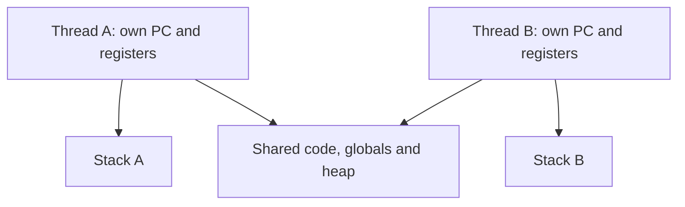
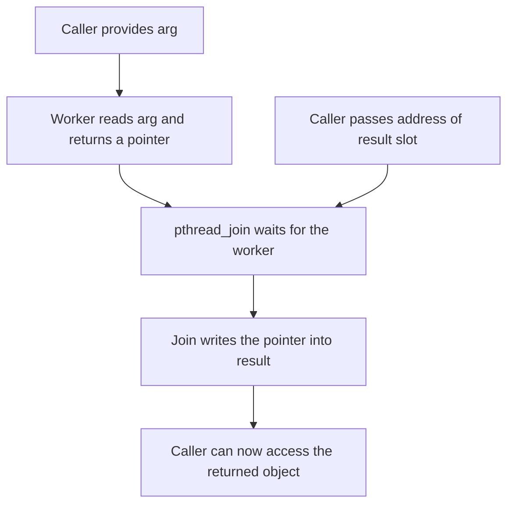

## Process vs. thread

Threads share the <mark>process address space</mark>, including code and heap, but each has its own <mark>registers, program counter and stack</mark>. A thread switch saves and restores execution state; switching between threads in the same address space does not require switching address spaces. Creation makes a thread runnable, not necessarily next to execute.

## Race conditions and atomicity

A source-level increment can become <mark>load, add and store</mark>. If both threads load the same value before either stores, the second store overwrites the first increment. A critical section touches shared state; <mark>mutual exclusion allows only one thread</mark> into it at a time. Atomicity means other participants cannot observe an operation half-complete.

## POSIX threads API

pthread_create takes a thread-ID destination, attributes, a start routine, and a void* argument. <mark>pthread_join waits</mark> and can write the routine’s void* result into caller-owned storage via void**. Never return a pointer into the terminating thread’s stack. Initialize mutexes and condition variables, check return values, and compile/link with -pthread where supported. trylock returns rather than waiting; a timed lock bounds the wait.

## Trace execution and thread lifetime

Concurrency is overlapping progress, not necessarily parallel execution. A same-process context switch saves the outgoing program counter, stack pointer and registers in its TCB and restores another TCB without changing the address space or page table. The PCB stores process-wide state.

The lecture’s two workers each attempt 10,000,000 increments, so the intended result after both joins is 20,000,000. `volatile` does not make a load/add/store atomic. In a real C program the unsynchronized data race is undefined behavior; in the lecture’s simplified trace, the later store loses an update. Protect the whole read–modify–write, not just the store.

`pthread_create(&tid, NULL, worker, arg)` uses default attributes. `void *result; pthread_join(tid, &result);` gives join a destination for the returned pointer; `NULL` discards it. Keep arguments alive until consumed, don’t share a changing loop index accidentally, and agree on who frees a returned heap allocation. Parallel phases often join before moving on; server workers may instead stay alive to handle queued requests. `pthread_mutex_timedlock` takes an absolute deadline. The deck shows `gcc -o main main.c -Wall -lpthread`; `-pthread` is a common compiler-driver alternative.

## Exam focus: predict what each thread sees

Threads share an address space but keep <mark>separate execution state</mark>. Joining a worker <mark>waits for completion</mark>; it does not synchronize the workers’ accesses to each other.

The memory diagrams on PDF pages 4–6 show separate stacks inside the **same** address space. A stack is normally owned by one thread, but another thread can access an object on it if given its address while the object is alive. The scheduling figures on pages 12–13 show why restoring a saved register can preserve a **stale** value across a context switch.

| Schedule, starting at 0 | A’s register | B’s register | Counter |
| --- | ---: | ---: | ---: |
| A loads and adds, then is preempted | 1 | — | 0 |
| B loads, adds, and stores | 1 | 1 | 1 |
| A resumes and stores its saved value | 1 | 1 | 1 |

### Follow the pointer through join

In PDF pages 22–24, `&result` locates the slot join updates; after the call, `result` identifies the object. Do not return a pointer to a worker’s local stack variable. To fix the counter example, lock **before** the load and unlock **after** the store. That protects the update from competing threads even if its owner gets preempted.
