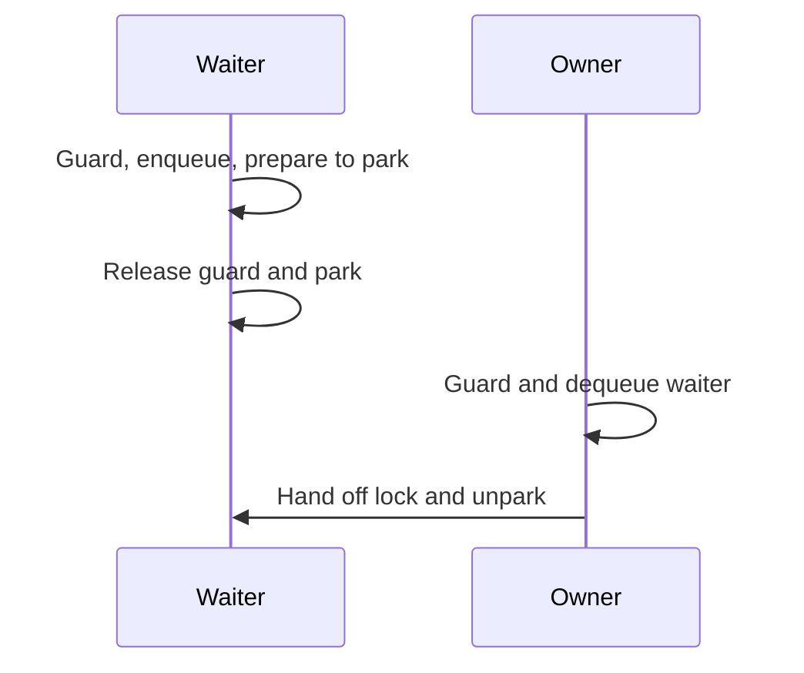
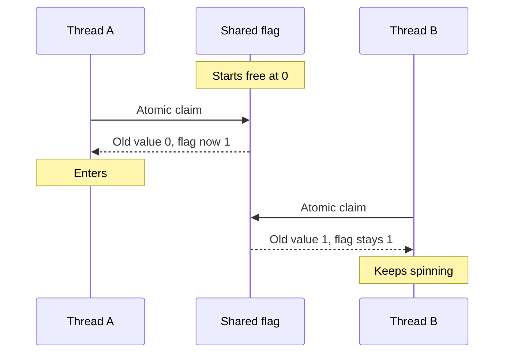
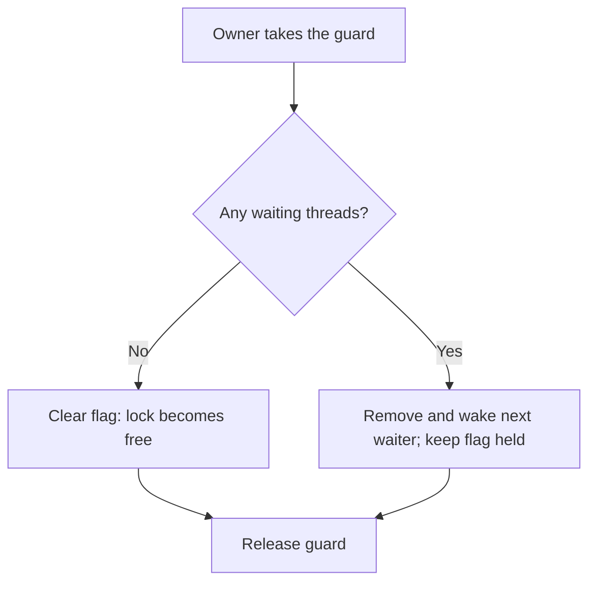

## What makes a good lock?

Evaluate <mark>correctness (mutual exclusion)</mark>, <mark>fairness (including starvation)</mark>, and performance under different contention and CPU conditions. Disabling interrupts is privileged and does not stop other CPUs. Separate ordinary load and store instructions cannot safely claim an unlocked flag.

## Atomic hardware primitives

Test-and-set swaps in a new value and <mark>returns the old one</mark>. Compare-and-swap only changes the value if it <mark>matches the expected one</mark>. Fetch-and-add returns the old value while incrementing; a ticket lock <mark>serves tickets in order</mark> using a separate turn counter. Real implementations also require proper memory ordering.

## Spin, yield or park?

Spinning repeatedly checks readiness and wastes CPU if the owner cannot run. Yield lets the scheduler try another runnable thread, but does not guarantee fairness. A guarded queue lets contenders sleep. Coordinate enqueue and sleep with wakeup (e.g. park preparation or a conditional wait) so a wake cannot disappear just before the contender parks.

## Compare implementations

| Mechanism | What changes state | Main limitation |
| --- | --- | --- |
| Disable interrupts | CPU defers local interrupts | Privileged; does not stop other cores |
| Separate test and set | Ordinary read then write | Two callers can both observe 0 and enter |
| Atomic test-and-set | Always writes and returns old value | Correct exclusion but not FIFO |
| Compare-and-swap | Writes only when the old value equals the expected value | Spinning CAS does not ensure fairness |
| Fetch-and-add | Increments and returns the old ticket | FIFO order, but still spins |
| Guarded queue | Enqueues and hands off to the next waiter | Must coordinate sleep and wakeup |

Mutual exclusion means never two owners. Progress means somebody can enter; starvation freedom means each waiter eventually enters under the scheduling assumptions. The lecture mentions Peterson’s algorithm as an example of software locking, unlike the broken naive test–set pair. With a preempted owner and N contenders, spinning can waste N−1 time slices. Yield moves a thread from running to ready, not asleep, so it can repeatedly be scheduled and yield without making progress.

The guard protects queue and lock bookkeeping, not the user’s critical section. Solaris `setpark()` handles the early-wake race by making a pending park return immediately; Linux futex waiting can check that the state is still as expected before sleeping. A two-phase lock spins briefly then blocks, balancing short handoff latency against wasted CPU when the owner is delayed.

## Exam focus: trace the lock flag, guard, and queue

A spinlock needs an <mark>atomic check-and-claim</mark>. A sleeping lock also needs to handle a <mark>wake that arrives before park</mark>.

### Watch two threads race for one lock

Start each example with `flag = 0` (**free**). `flag = 1` means **held**. Read downward in time.

**Separate check and write — broken (PDF pages 8–11)**

| Step | Thread A | Thread B | Shared flag after step |
| --- | --- | --- | --- |
| 1 | Reads 0, leaves the loop, then pauses | — | `0` |
| 2 | — | Reads 0 and leaves the loop too | `0` |
| 3 | — | Writes 1 and enters | `1` |
| 4 | Resumes, writes 1 and enters | Still inside | `1` |

At step 4, A does not recheck the flag. <mark>Both threads are inside.</mark> The problem is the gap between **seeing** a free lock and **claiming** it.

**Atomic check and claim — one owner (PDF pages 13–18)**

Both instructions let A in and keep B waiting, but they do different things at the flag:

| Operation | A sees `0` | B sees `1` |
| --- | --- | --- |
| `TestAndSet(flag, 1)` | Writes `1`, returns `0` | Writes `1` again, returns `1` |
| `CAS(flag, 0, 1)` | Expected `0` matches: writes `1`, returns `0` | Expected `0` does not match: **no write**, returns `1` |

In these lecture versions, the return is the **old** value. A return of `0` tells a thread it claimed a free lock; a return of `1` tells it to retry. A ticket lock works differently: it hands out unique tickets and waits until the current `turn` matches.

### Follow ownership at unlock

The `guard` protects bookkeeping, while `flag` protects entry into the user’s critical section. In the queued case, <mark>keep the flag held during handoff</mark> so a new caller cannot jump ahead. On PDF pages 28–30, the waiter calls `setpark` before releasing the guard; a wake that arrives before the actual `park` is then remembered.
