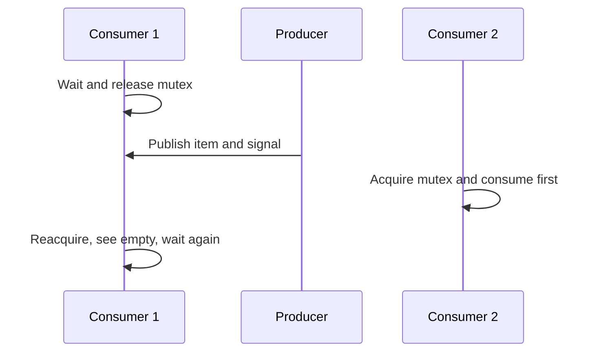
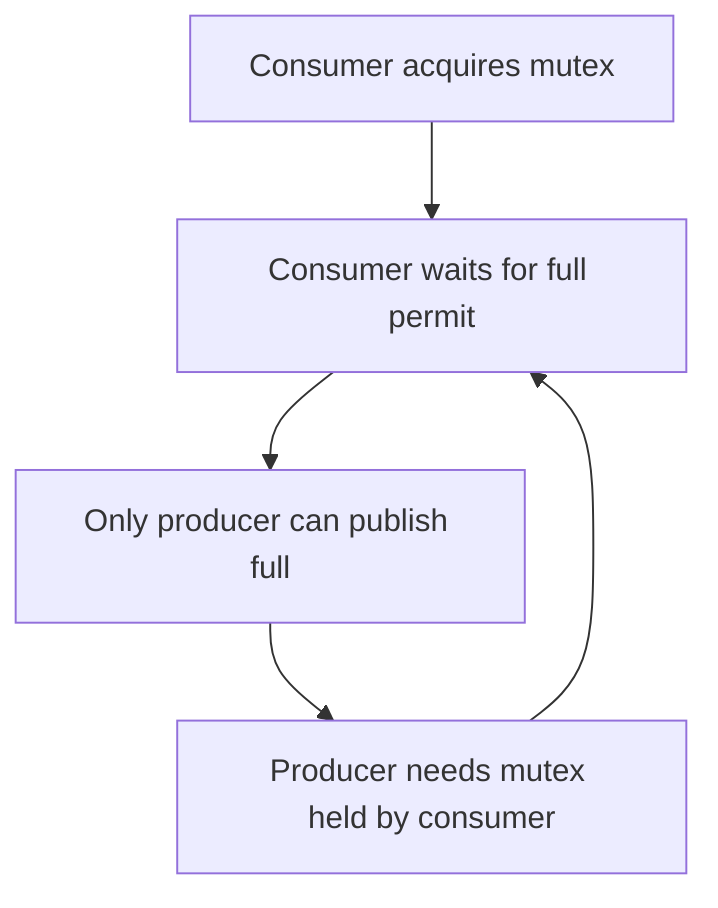

## Condition variables

A condition variable is a waiting mechanism, <mark>not the predicate itself</mark>. Hold the mutex while testing shared state; wait <mark>atomically releases the mutex</mark> and blocks, then <mark>reacquires it before returning</mark>. Change the predicate under the same mutex. Signal wakes a waiter if present, but <mark>does not store a permit</mark>.

## Producer/consumer with conditions

Track buffer occupancy under the mutex. A woken thread is merely eligible to run: another thread can change the predicate before it reacquires the lock, and spurious wakeups are possible. Use while, not if. Separate not-empty and not-full conditions target the right group. A circular buffer advances fill/use indexes modulo capacity.

## Counting and binary semaphores

wait consumes a permit or blocks; post makes a permit available or enables a waiter. Initialize a binary semaphore to 1 for mutual exclusion or to 0 for an event. A bounded buffer starts empty=capacity and full=0; <mark>reserve a slot/item before taking the mutex</mark>, update the buffer, unlock, then post to the other semaphore. Waiting for capacity while holding the buffer mutex can deadlock.

## Trace the two buffer bugs separately

For a parent waiting on a child, the parent checks `while (!done)` under the mutex; the child sets `done = true` and signals under that mutex. If the child runs first, the parent sees the stored state. The condition variable itself does not save a permit. `signal` wakes one waiter if present; `broadcast` wakes all, and each must reacquire the lock and recheck.



Split `not_full` from `not_empty` to fix the wrong-queue bug; use `while` to fix the predicate bug. In a ring with capacity N, advance `fill` after writing and `use` after reading, modulo N. A count distinguishes full from empty when both indices coincide.

| Phase | Producer | Consumer |
| --- | --- | --- |
| Reserve | `sem_wait(empty)` | `sem_wait(full)` |
| Update | lock → put → unlock | lock → get → unlock |
| Publish | `sem_post(full)` | `sem_post(empty)` |

In `sem_init(&s, 0, initial)`, zero in the second argument means shared among threads of the same process. Capacity permits do not protect the buffer indices. Waiting for `full` while holding the mutex prevents producers from filling the buffer; unlike condition wait, semaphore wait does not release that mutex. Implement a semaphore with a mutex, count and condition: while count is zero, wait; then decrement. Post increments and signals under the lock.

## Exam focus: fill in synchronization code

Check the condition in a <mark>while loop</mark>, and <mark>reserve a permit before locking</mark> when using semaphores for the buffer.

The final buffer figures on PDF pages 21–22 pair each predicate with its own waiting queue. The mutex is held at entry to each sequence and released at the end:

```text
Producer: while count == N: wait(not_full, mutex)
          put at fill; advance fill; increment count; signal(not_empty)
Consumer: while count == 0: wait(not_empty, mutex)
          get from use; advance use; decrement count; signal(not_full)
```

With capacity 3 and `fill = 2`, follow the writes across the end of the array:

| Event | Slot 0 | Slot 1 | Slot 2 | Next fill |
| --- | --- | --- | --- | ---: |
| Start empty | — | — | — | 2 |
| Put A | — | — | A | 0 |
| Put B | B | — | A | 1 |

Starting with `use = 2`, the consumer reads A then B. The count distinguishes full from empty even if the cursors coincide.



Fix the code on PDF pages 31–34 by taking the permit **before** the mutex. In the semaphore implementation on page 35, a condition wait is different: it releases the internal mutex while waiting, then reacquires it before decrementing the count. Post increments the count and signals under that mutex.
